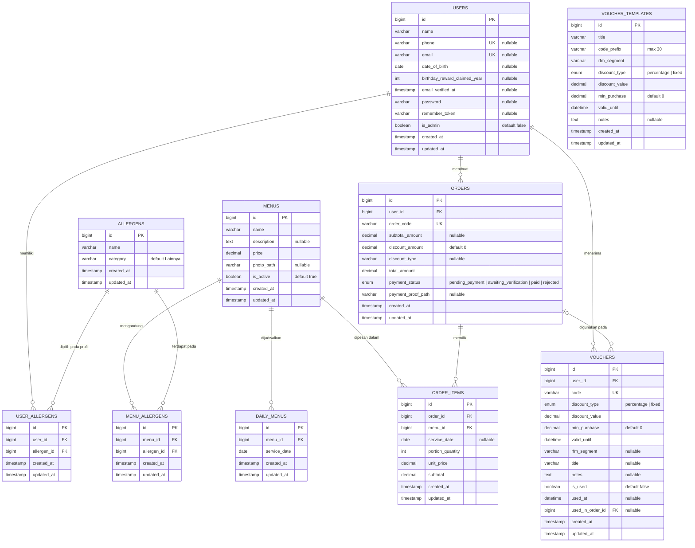

# ERD Dova Kitchen

Dokumen ini menggambarkan struktur basis data domain aplikasi Dova Kitchen berdasarkan kondisi akhir migration Laravel.

## Diagram ERD

## Atribut dan constraint

Keterangan: `PK` = primary key, `FK` = foreign key, `UK` = unique key, `nullable` = boleh bernilai `NULL`.

### `users`

| Atribut | Tipe | Constraint / Keterangan |
|---|---|---|
| `id` | `BIGINT UNSIGNED` | PK, auto increment |
| `name` | `VARCHAR` | Wajib |
| `phone` | `VARCHAR` | Nullable, unique |
| `email` | `VARCHAR` | Nullable, unique |
| `date_of_birth` | `DATE` | Nullable |
| `birthday_reward_claimed_year` | `INTEGER` | Nullable, tahun reward ulang tahun terakhir |
| `email_verified_at` | `TIMESTAMP` | Nullable |
| `password` | `VARCHAR` | Nullable |
| `remember_token` | `VARCHAR(100)` | Nullable |
| `is_admin` | `BOOLEAN` | Default `false` |
| `created_at` | `TIMESTAMP` | Laravel timestamp |
| `updated_at` | `TIMESTAMP` | Laravel timestamp |

### `allergens`

| Atribut | Tipe | Constraint / Keterangan |
|---|---|---|
| `id` | `BIGINT UNSIGNED` | PK, auto increment |
| `name` | `VARCHAR` | Wajib |
| `category` | `VARCHAR` | Wajib, default `Lainnya` |
| `created_at` | `TIMESTAMP` | Laravel timestamp |
| `updated_at` | `TIMESTAMP` | Laravel timestamp |

### `menus`

| Atribut | Tipe | Constraint / Keterangan |
|---|---|---|
| `id` | `BIGINT UNSIGNED` | PK, auto increment |
| `name` | `VARCHAR` | Wajib |
| `description` | `TEXT` | Nullable |
| `price` | `DECIMAL(10,2)` | Wajib |
| `photo_path` | `VARCHAR` | Nullable |
| `is_active` | `BOOLEAN` | Default `true` |
| `created_at` | `TIMESTAMP` | Laravel timestamp |
| `updated_at` | `TIMESTAMP` | Laravel timestamp |

> Jadwal layanan tidak lagi disimpan di `menus`. Jadwal disimpan pada `daily_menus` melalui migration `remove_service_date_from_menus_table`.

### `daily_menus`

| Atribut | Tipe | Constraint / Keterangan |
|---|---|---|
| `id` | `BIGINT UNSIGNED` | PK, auto increment |
| `menu_id` | `BIGINT UNSIGNED` | FK ke `menus.id`, cascade saat menu dihapus |
| `service_date` | `DATE` | Wajib |
| `created_at` | `TIMESTAMP` | Laravel timestamp |
| `updated_at` | `TIMESTAMP` | Laravel timestamp |

Unique gabungan: `menu_id` + `service_date`.

### `orders`

| Atribut | Tipe | Constraint / Keterangan |
|---|---|---|
| `id` | `BIGINT UNSIGNED` | PK, auto increment |
| `user_id` | `BIGINT UNSIGNED` | FK ke `users.id`, cascade saat user dihapus |
| `order_code` | `VARCHAR` | Wajib, unique |
| `subtotal_amount` | `DECIMAL(12,2)` | Nullable |
| `discount_amount` | `DECIMAL(12,2)` | Default `0` |
| `discount_type` | `VARCHAR` | Nullable, label atau sumber diskon |
| `total_amount` | `DECIMAL(12,2)` | Wajib |
| `payment_status` | `ENUM` | `pending_payment`, `awaiting_verification`, `paid`, atau `rejected`; default `pending_payment` |
| `payment_proof_path` | `VARCHAR` | Nullable |
| `created_at` | `TIMESTAMP` | Laravel timestamp |
| `updated_at` | `TIMESTAMP` | Laravel timestamp |

### `order_items`

| Atribut | Tipe | Constraint / Keterangan |
|---|---|---|
| `id` | `BIGINT UNSIGNED` | PK, auto increment |
| `order_id` | `BIGINT UNSIGNED` | FK ke `orders.id`, cascade saat order dihapus |
| `menu_id` | `BIGINT UNSIGNED` | FK ke `menus.id`, cascade saat menu dihapus |
| `service_date` | `DATE` | Nullable, tanggal layanan menu pada order |
| `portion_quantity` | `INTEGER` | Wajib |
| `unit_price` | `DECIMAL(10,2)` | Wajib, harga per porsi saat dipesan |
| `subtotal` | `DECIMAL(12,2)` | Wajib |
| `created_at` | `TIMESTAMP` | Laravel timestamp |
| `updated_at` | `TIMESTAMP` | Laravel timestamp |

### `vouchers`

| Atribut | Tipe | Constraint / Keterangan |
|---|---|---|
| `id` | `BIGINT UNSIGNED` | PK, auto increment |
| `user_id` | `BIGINT UNSIGNED` | FK ke `users.id`, cascade saat user dihapus |
| `code` | `VARCHAR` | Wajib, unique |
| `discount_type` | `ENUM` | `percentage` atau `fixed`; default `percentage` |
| `discount_value` | `DECIMAL(12,2)` | Wajib |
| `min_purchase` | `DECIMAL(12,2)` | Default `0` |
| `valid_until` | `DATETIME` | Wajib |
| `rfm_segment` | `VARCHAR` | Nullable |
| `title` | `VARCHAR` | Nullable |
| `notes` | `TEXT` | Nullable |
| `is_used` | `BOOLEAN` | Default `false` |
| `used_at` | `DATETIME` | Nullable |
| `used_in_order_id` | `BIGINT UNSIGNED` | Nullable, FK ke `orders.id`, menjadi `NULL` jika order dihapus |
| `created_at` | `TIMESTAMP` | Laravel timestamp |
| `updated_at` | `TIMESTAMP` | Laravel timestamp |

### `voucher_templates`

| Atribut | Tipe | Constraint / Keterangan |
|---|---|---|
| `id` | `BIGINT UNSIGNED` | PK, auto increment |
| `title` | `VARCHAR` | Wajib |
| `code_prefix` | `VARCHAR(30)` | Wajib |
| `rfm_segment` | `VARCHAR` | Wajib |
| `discount_type` | `ENUM` | `percentage` atau `fixed` |
| `discount_value` | `DECIMAL(12,2)` | Wajib |
| `min_purchase` | `DECIMAL(12,2)` | Default `0` |
| `valid_until` | `DATETIME` | Wajib |
| `notes` | `TEXT` | Nullable |
| `created_at` | `TIMESTAMP` | Laravel timestamp |
| `updated_at` | `TIMESTAMP` | Laravel timestamp |

`voucher_templates` tidak memiliki foreign key ke `vouchers`. Saat voucher diterbitkan, atribut template disalin ke record `vouchers`.

### `user_allergens`

| Atribut | Tipe | Constraint / Keterangan |
|---|---|---|
| `id` | `BIGINT UNSIGNED` | PK, auto increment |
| `user_id` | `BIGINT UNSIGNED` | FK ke `users.id`, cascade saat user dihapus |
| `allergen_id` | `BIGINT UNSIGNED` | FK ke `allergens.id`, cascade saat allergen dihapus |
| `created_at` | `TIMESTAMP` | Laravel timestamp |
| `updated_at` | `TIMESTAMP` | Laravel timestamp |

Tabel ini merepresentasikan relasi many-to-many antara pengguna dan alergi/pantangan makanan.

### `menu_allergens`

| Atribut | Tipe | Constraint / Keterangan |
|---|---|---|
| `id` | `BIGINT UNSIGNED` | PK, auto increment |
| `menu_id` | `BIGINT UNSIGNED` | FK ke `menus.id`, cascade saat menu dihapus |
| `allergen_id` | `BIGINT UNSIGNED` | FK ke `allergens.id`, cascade saat allergen dihapus |
| `created_at` | `TIMESTAMP` | Laravel timestamp |
| `updated_at` | `TIMESTAMP` | Laravel timestamp |

Tabel ini merepresentasikan relasi many-to-many antara menu dan allergen yang dikandungnya.

## Ringkasan relasi

| Relasi | Kardinalitas | Implementasi |
|---|---|---|
| `users` - `orders` | 1 : N | `orders.user_id` |
| `users` - `vouchers` | 1 : N | `vouchers.user_id` |
| `users` - `allergens` | M : N | Pivot `user_allergens` |
| `menus` - `daily_menus` | 1 : N | `daily_menus.menu_id` |
| `menus` - `order_items` | 1 : N | `order_items.menu_id` |
| `menus` - `allergens` | M : N | Pivot `menu_allergens` |
| `orders` - `order_items` | 1 : N | `order_items.order_id` |
| `orders` - `vouchers` | 1 : N secara database, voucher opsional | `vouchers.used_in_order_id` |
| `voucher_templates` - `vouchers` | Tidak ada FK langsung | Data template disalin saat penerbitan voucher |

## Tabel infrastruktur Laravel yang tidak digambarkan

ERD di atas hanya mencakup data bisnis Dova Kitchen. Migration bawaan Laravel juga membuat tabel `password_reset_tokens`, `sessions`, `cache`, `cache_locks`, `jobs`, `job_batches`, dan `failed_jobs`; tabel-tabel tersebut tidak memiliki relasi bisnis dengan ERD ini.
